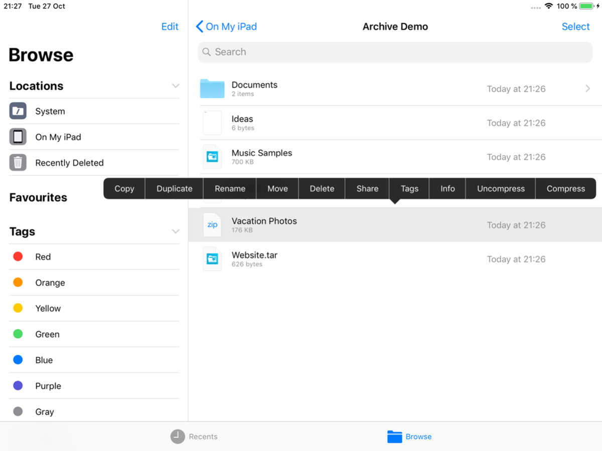
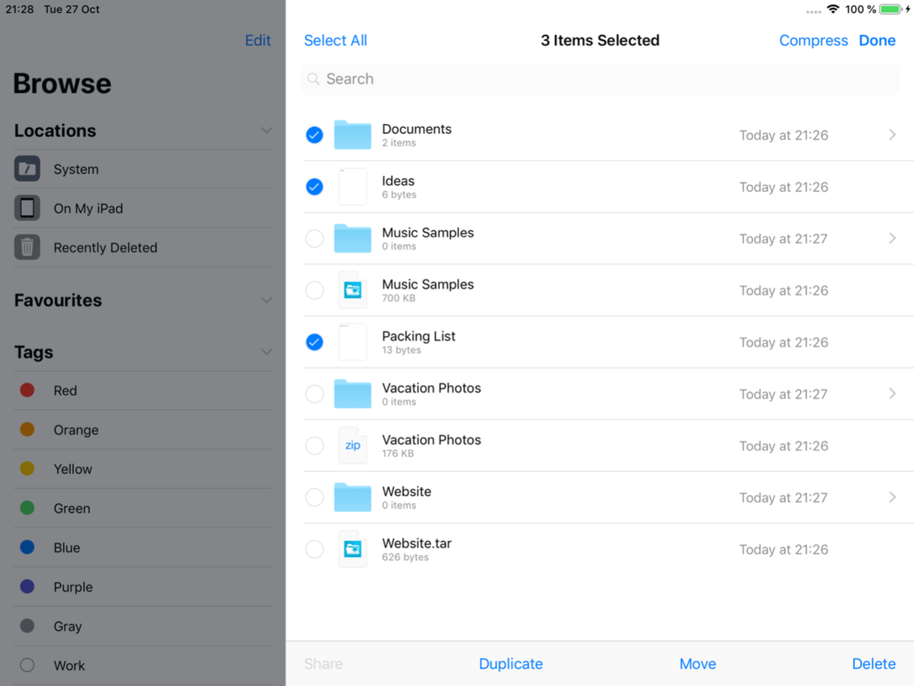
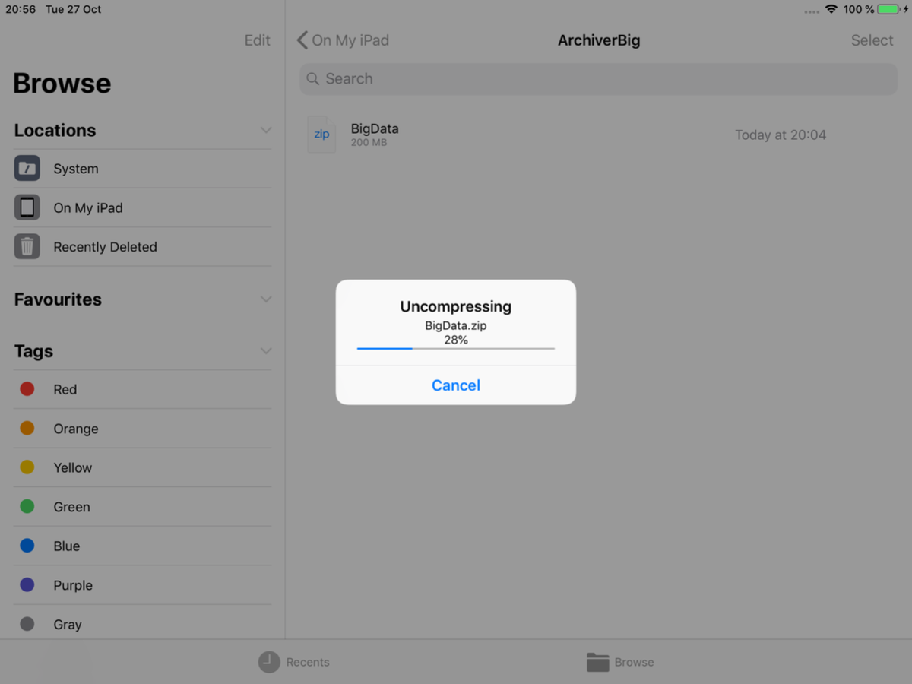
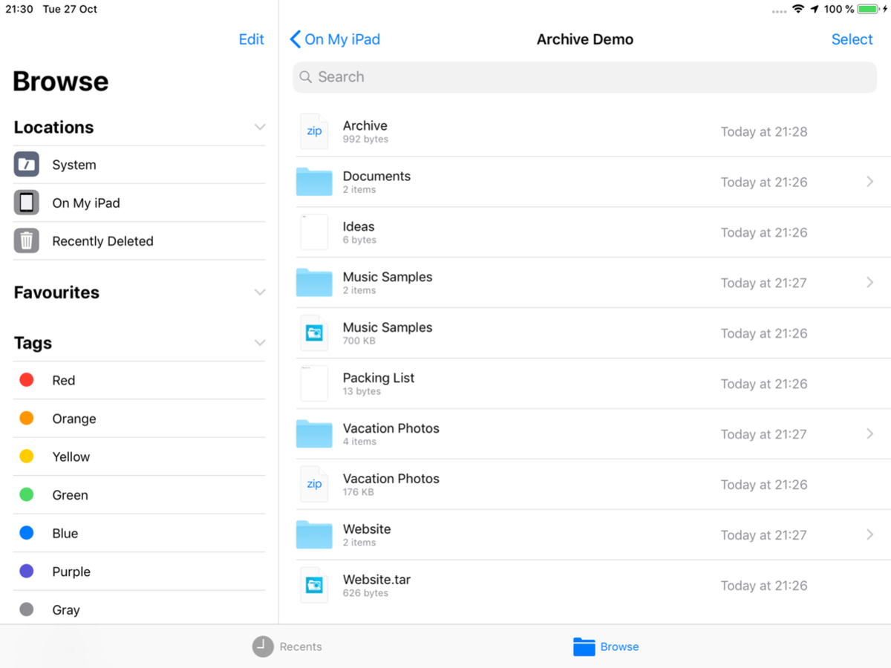
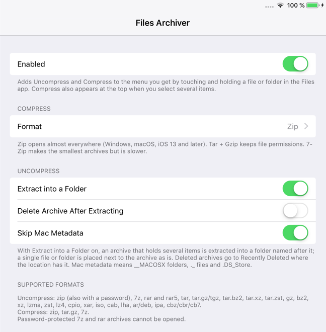

<p align="center"></p>

<h1 align="center">FilesArchiver (iOS 12)</h1>

**Uncompress and Compress in the Files app on iOS 12, like iOS 13 does.**

On iOS 12 the Files app can only peek into a zip file ("Preview Content"). It can't extract it, and it can't make archives at all.

FilesArchiver adds **Uncompress** and **Compress** to the menu you get when you touch and hold an item, and **Compress** to the top bar when you select several items. It opens zip (including password-protected zips), 7z, rar, tar, tar.gz and many more, and creates zip, tar.gz or 7z archives.

This is an unofficial jailbreak tweak. It is not affiliated with or endorsed by Apple.

## Screenshots

| Touch and hold an archive | Select several items, tap Compress |
| --- | --- |
|  |  |

| Progress, with Cancel | Results go next to the archive |
| --- | --- |
|  |  |

Settings > Files Archiver:



## Features

- **Uncompress:** zip (with a password prompt for password-protected zips), 7z, rar and rar5, tar, tar.gz/tgz, tar.bz2, tar.xz, tar.zst, gz, bz2, xz, lzma, zst, lz4, cpio, xar, iso, cab, lha, ar/deb, ipa, cbz/cbr/cb7.
- **Compress:** zip (default), tar.gz or 7z, chosen in Settings. Works for one file, several files and folders.
- **Names like iOS 13:** `Name.zip` for one item, `Archive.zip` for several, a folder named after the archive when extracting, and " 2", " 3"... instead of overwriting anything.
- **Progress with Cancel** for long jobs. The work runs in the background, so Files stays responsive. Memory use stays flat, even with a 200 MB archive or an archive of 50,000 files on a 1 GB iPad.
- **Checks before it starts:** the folder must accept new items, and at least 500 MB must stay free on the device. A job that can't finish stops, cleans up and tells you why.
- Results are handed to the location's file provider, so they show up right away and the location's own rules apply.
- Changes in Settings apply right away. No respring needed.

## Safety

Archives are treated as untrusted:

- Paths with `../` are skipped, and absolute paths are made relative.
- Nothing is written through a link or over an existing file. Links are created last, only relative ones, and a link is kept only if it points inside its own extracted item.
- Hard links must point at a file from the same archive. Devices, pipes and sockets are skipped.
- Everything is extracted into a private folder first. Only the checked result is moved next to the archive. If anything was skipped, Files tells you how many items and why. Damaged entries (bad CRC) are left out and the rest is kept.
- Files that aren't archives, damaged archives and unsupported encryption get a clear message instead of a crash.

## Compatibility

- Tested on an iPad mini 2 with iOS 12.5.8, jailbroken with checkra1n + odysseyra1n (Procursus, libhooker).
- Expected to work on iOS 12.x. It should work on iPhone too, but it has only been tested on iPad.
- Needs `libarchive13` from Procursus. Your package manager installs it automatically.
- Works alongside [FilesRoot](https://github.com/itsAllexB/FilesRoot-iOS12) and [FilesExtensions](https://github.com/itsAllexB/FilesExtensions-iOS12).

## Install

Add the **iOS Legacy** source to your package manager, then search for FilesArchiver:

```
https://itsallexb.github.io/ios-legacy/
```

One tap on your device: [Add to Sileo](https://itsallexb.github.io/ios-legacy/add/sileo.html) · [Add to Zebra](https://itsallexb.github.io/ios-legacy/add/zebra.html) · [Add to Cydia](https://itsallexb.github.io/ios-legacy/add/cydia.html)

Or download the `.deb` from [Releases](https://github.com/itsAllexB/FilesArchiver-iOS12/releases/latest) and install it with Filza or `dpkg -i`, then reopen Files. (Install `libarchive13` first if you install the `.deb` by hand.)

Requires `mobilesubstrate` (Substrate, Substitute or libhooker), PreferenceLoader and `libarchive13`. Your package manager installs them automatically.

## Settings

Open **Settings > Files Archiver**:

- **Enabled**: turns the tweak on or off.
- **Format**: what Compress creates. *Zip* (default) opens almost everywhere. *Tar + Gzip* keeps file permissions. *7-Zip* makes the smallest archives but is slower.
- **Extract into a Folder** (on by default): an archive that holds several items is extracted into a folder named after it. A single file or folder is placed next to the archive as it is.
- **Delete Archive After Extracting** (off by default): moves the archive to Recently Deleted after a successful extraction. It never deletes it permanently.
- **Skip Mac Metadata** (on by default): leaves out `__MACOSX` folders, `._` files and `.DS_Store`.

## Known limits

- Password-protected 7z and rar archives can't be opened (libarchive doesn't support their encryption). Password-protected zips work.
- Multi-volume archives (`.part1.rar`, `.7z.001`) aren't supported.
- A freshly extracted folder may show "0 items" until Files is reopened. Its contents are there.
- "Delete Archive After Extracting" uses the same operation as Files' own Delete. Where that fails, the archive is kept and a message explains why. On iOS 12 this happens for items placed directly in the top level of On My iPad (outside an app's folder), where Files' own Delete fails too.
- Uncompress and Compress can't be hidden per folder. Where new items aren't accepted (the top level of On My iPad, a read-only location), they are refused at once with a message.
- Created zip and 7z archives keep only the executable bit of file permissions, and never store owners.
- Names over 255 bytes and paths nested too deeply for iOS are skipped (and counted in the message).
- 7z compression keeps about 1 KB per file in memory, so a 7z of tens of thousands of files uses tens of MB. zip and tar.gz stay flat.
- If Files stays in the background longer than iOS allows (about 3 minutes), the job is stopped. Nothing is changed, and a message explains it when Files is opened again.

## Build from source

You need [Theos](https://theos.dev/docs/installation) and an iOS SDK (the Makefile uses the iOS 14.5 SDK and targets iOS 12.0, arm64).

```sh
git clone https://github.com/itsAllexB/FilesArchiver-iOS12.git
cd FilesArchiver-iOS12
make package FINALPACKAGE=1
```

The package is written to `packages/`. To install it on a device over SSH, set `THEOS_DEVICE_IP` and run `make install`.

What's in this repo:

- `Tweak.x`: the Files app side. It adds two `UIDocumentBrowserAction`s (the public iOS 11 API that document apps use for the long-press menu) to Files' own document browser, runs the jobs, shows progress and errors, and hands the results to the location's File Provider with `-importDocumentAtURL:nextToDocumentAtURL:mode:completionHandler:`.
- `FAArchiver.m`: the archive engine, on top of libarchive. Extraction doesn't use `archive_write_disk`: every entry is checked and written by hand, as described in the comments at the top of the file.
- `prefs/`, `layout/`: the Settings page.
- `vendor/libarchive/`: only libarchive's headers and a link stub (BSD-2-Clause, see `vendor/libarchive/COPYING`). The library itself comes from the `libarchive13` package on the device.

## Credits and license

Made by [itsAllexB](https://github.com/itsAllexB). Archive support by [libarchive](https://www.libarchive.org/) (BSD-2-Clause).

FilesArchiver is free software under the GNU General Public License v3.0 or later. See [LICENSE](LICENSE).

iPad, iPhone and Files are trademarks of Apple Inc. This project is not affiliated with Apple.
